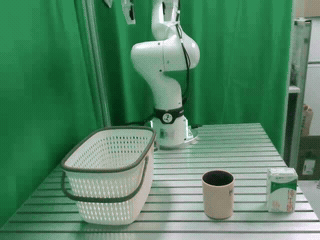
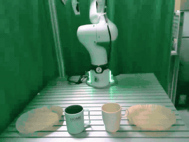
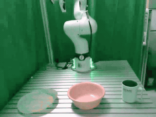

# Recursia: Recursive Self-Improvement for Robot Manipulation

[Project Page](https://lfrlll.github.io/Recursia/) &ensp;|&ensp; [Real-Robot Quick Start](recursia/real/README.md) &ensp;|&ensp; [Simulation](recursia/sim/README.md)

Recursia improves a shared executable Python stack from source-task feedback,
then reuses the frozen stack on new task compositions. Improvements persist as
programs rather than model-weight updates.

This repository currently provides experiments on a Franka FR3 with a Franka
Hand, including a Skill Document Only (SD-only) baseline. Simulation code will be added under `recursia/sim/`.

## Quick Start

Create the environment for the Franka FR3 workspace:

```bash
git clone https://github.com/cyzhuoda/Recursia.git
cd Recursia/recursia/real
conda env create -f environment.yml
conda activate recursia
```

Follow the [real-robot setup guide](recursia/real/README.md) to configure your
station and install/start SAM3 and Contact-GraspNet. Once ready, run the first
source chunk:

```bash
python run_agent.py rsi init --campaign logs/my_campaign
OPENFORGE_ALLOW_PHYSICAL_MOTION=1 python run_agent.py rsi source \
  --campaign logs/my_campaign --method recursia --chunk 1 \
  --config config/rsi_fr3_station.local.yaml
```

See [Run](recursia/real/README.md#run) for the remaining chunks, SD-only baseline,
and target evaluation.

## Demonstrations

Selected successful Recursia target executions on Franka FR3. Videos play at
original speed and concatenate recorded action segments; unrecorded perception
and model-wait intervals are omitted. Click a preview to open the full MP4.
Animated previews below run at 4x speed.

<table>
  <thead>
    <tr><th>Task</th><th>Composition</th><th>Video</th></tr>
  </thead>
  <tbody>
    <tr>
      <td>T1: Shared basket</td>
      <td>Place both the mug and the carton of milk in the basket.</td>
      <td><a href="assets/media/T1.mp4"></a><br><a href="assets/media/T1.mp4">Watch T1</a></td>
    </tr>
    <tr>
      <td>T2: Reassigned plates</td>
      <td>Place the blue mug on the left plate and the white mug on the right plate.</td>
      <td><a href="assets/media/T2.mp4"></a><br><a href="assets/media/T2.mp4">Watch T2</a></td>
    </tr>
    <tr>
      <td>T3: Bowl--mug dependency</td>
      <td>First place the bowl on the plate, then place the mug in the relocated bowl.</td>
      <td><a href="assets/media/T3.mp4"></a><br><a href="assets/media/T3.mp4">Watch T3</a></td>
    </tr>
  </tbody>
</table>

## Repository layout

```text
Recursia/
├── recursia/
│   ├── real/             # Physical RSI runner, tools, configs and tests
│   │   ├── cap/
│   │   ├── config/
│   │   ├── patches/
│   │   ├── robot/
│   │   ├── tools/
│   │   ├── environment.yml
│   │   ├── pyproject.toml
│   │   └── run_agent.py
│   └── sim/              # Reserved for future simulation experiments
├── assets/media/         # Selected target demonstration videos
├── LICENSES/
├── LICENSE
├── NOTICE
└── README.md
```

Logs, raw experiment recordings, model checkpoints, local station configurations, papers, and
independent experiment protocol documents are excluded from this repository.
Runtime prompt code required by the agents is included.

## Contribution Guidelines

See [CONTRIBUTING.md](CONTRIBUTING.md). Run the offline tests from `recursia/real/` when
changing the physical runner. Keep simulation dependencies and coordinates
separate from real-robot configuration.

## License

Inherited ASPIRE copyright notices are retained. Project material is available
under the [Apache License 2.0](LICENSE), subject to component-specific terms.
See [NOTICE](NOTICE) and the [license inventory](LICENSES/README.md).

## Citation

This implementation builds on ASPIRE. Please acknowledge the upstream work
when using its inherited components:

```bibtex
@article{lu2026aspire,
  title   = {ASPIRE: Agentic /Skills Discovery for Robotics},
  author  = {Runyu Lu and Yubo Wu and Ethan Kou and Letian Fu and Wenli Xiao and
             Ajay Mandlekar and Yinzhen Xu and Guanya Shi and Ken Goldberg and
             Ang Chen and Mosharaf Chowdhury and Yuke Zhu and Linxi "Jim" Fan and Guanzhi Wang},
  year    = {2026},
  journal = {arXiv preprint arXiv:2607.00272},
  url     = {https://arxiv.org/abs/2607.00272}
}
```
